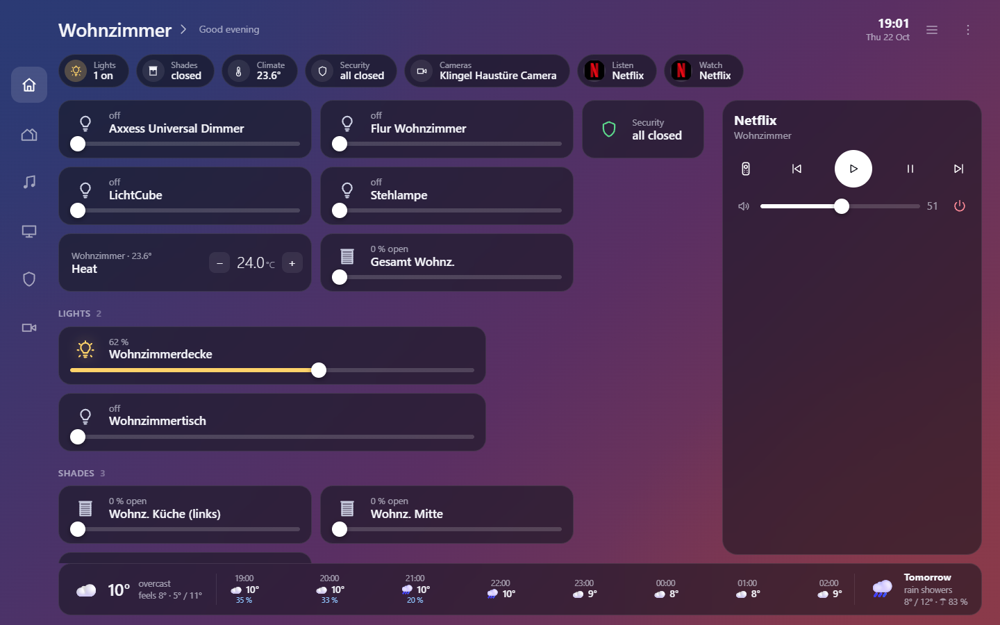
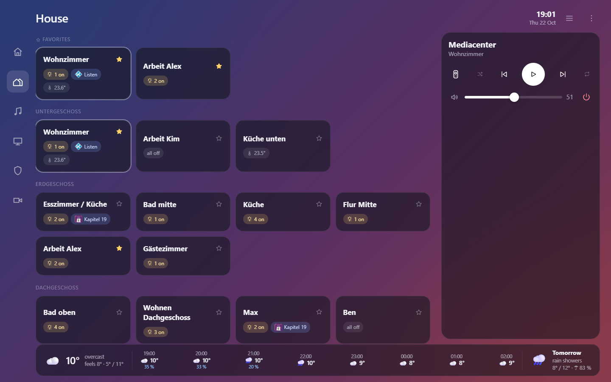
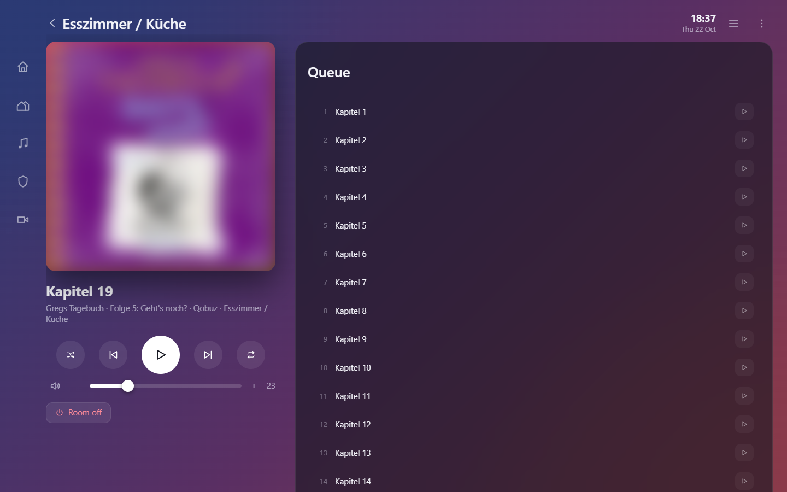
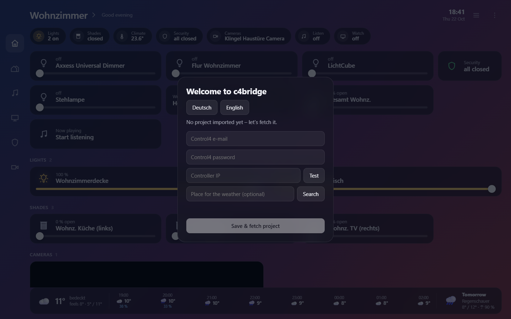
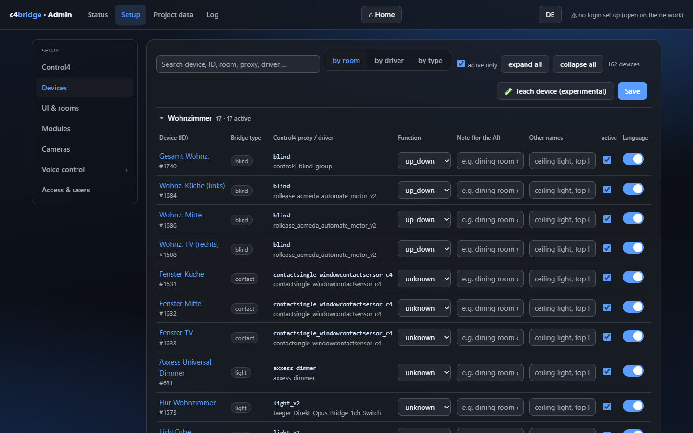
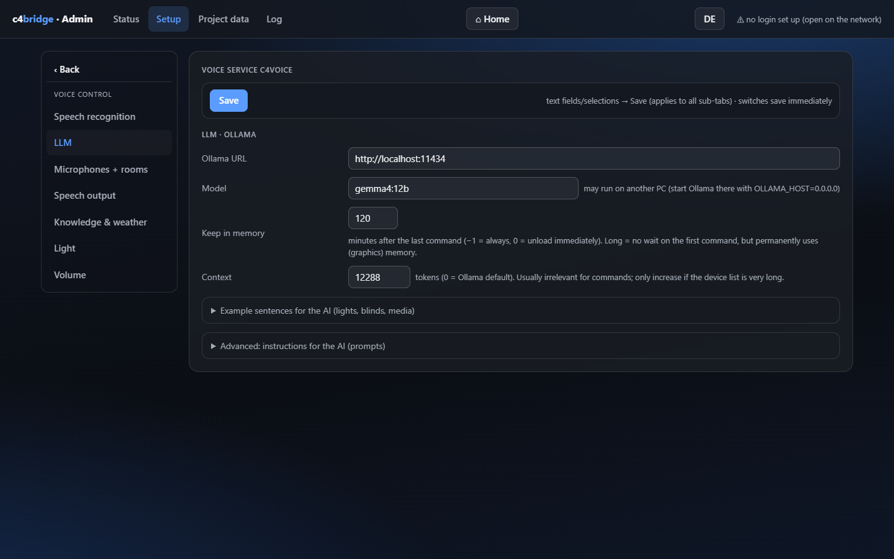

# c4bridge

A local web bridge for **Control4** home automation: a fast browser UI for the PC, an admin console, and an
optional **local voice assistant** (wake word → Whisper → LLM via Ollama → actions → speech output).
Everything runs inside your home network. No cloud services are needed except the Control4 account login.

**What makes the voice assistant different: you talk to it the way you talk at home.**
- **Natural speaking, no pause.** Say *"Hey Jarvis, turn the lights on"* in one breath. You don't wait for a beep
  after the wake word: the bridge keeps a rolling audio buffer, so the start of your command is never lost.
- **No exact device names needed.** *"Make it a bit brighter"*, *"lights on"*, *"too dark"*, *"close everything"*,
  *"make it cosy"* just work:
  - The room you are in is the default.
  - The LLM picks the matching devices itself.
  - Misheard names are matched to the closest device.
  - If it really is ambiguous, it asks back (*"Which office do you mean?"*).

> Unofficial hobby project. Not affiliated with or endorsed by Snap One / Control4. Use at your own risk.
> UI and voice assistant in German and English (see [Languages](#languages)).



## Screenshots

| | |
|---|---|
|  |  |
| **House overview**: all rooms by floor, with favourites | **Now playing**: BluOS/Qobuz with the queue |
|  |  |
| **Setup wizard** on first start | **Admin**: devices with notes and alias names for the voice assistant |
|  | |
| **Voice settings**: the local LLM via Ollama | |

## Main features

**Control UI (browser, desktop-first)**
- Rooms and floors, imported automatically from your Control4 project (Composer visibility respected).
- Lights (on/off and dimming), blinds and blind groups, thermostats, door/window contacts and motion sensors.
- Live state through the Director WebSocket push, with a polling fallback.
- Per-room volume, mute, play/pause and now-playing info, taken from the Composer bindings.
- Customisable home screen: drag-and-drop tiles and per-user favourites.
- Cameras: snapshots, or a low-latency live stream (RTSP → HLS through [MediaMTX](https://github.com/bluenviron/mediamtx)).
- Weather from Open-Meteo.

**Music and video**
- The Control4 music library ("My Music").
- BluOS players (Bluesound / NAD), with Qobuz, radio and inputs:
  - Found through mDNS and the driver addresses.
  - Matched to Control4 rooms automatically.
- KODI: library browsing and playback.

**Admin console (`/admin`)**
- Setup wizard: Control4 login, controller discovery, location and camera streaming.
- Devices: hide devices, fix device types, add notes and alias names (the voice assistant uses these).
- Users and roles (admin / user): PBKDF2-hashed passwords and signed session cookies.
- Optional HTTPS with a self-signed certificate, needed for browser microphones on other devices.
- Live log, diagnostics and a re-import of the project after changes in Composer.
- **Driver learning wizard**: records the events of an unknown driver and stores a driver profile as data, not code.

**Voice assistant `c4voice` (optional)**
- **Natural speaking**: wake word and command in one sentence, without a pause.
  - A rolling 5 s audio buffer runs all the time.
  - When the wake word is detected, the last 2.2 s (wake word plus the start of the command) are kept.
- **Colloquial commands instead of device names**:
  - *"make it brighter"*, *"lights off"*, *"blinds down"*, *"louder"*, *"play some music"*.
  - Commands without a room apply to the room of the microphone.
  - Device and room names are matched fuzzily, including misheard ones.
  - Follow-up questions when a command is ambiguous (*"Which lamp do you mean?"*), answered without repeating the wake word.
- Wake word: openWakeWord.
- Speech recognition:
  - Whisper on the GPU through whisper.cpp with Vulkan (**recommended**: much better recognition, about 0.3 s per sentence).
  - Or Whisper on the CPU (faster-whisper).
- Intent handling by a local LLM through Ollama with tool calls. Tested best with `gemma4:12b`: 75 of 75 German test sentences correct, about 0.7 s per command.
  - Simple German commands (*"Pause"*, *"lauter"*) work without the LLM.
- Speech output:
  - **Qwen3-TTS** (GPU, **recommended**: much more natural than Piper). It clones the voice from a 5–10 s reference clip; two generated sample voices are included.
  - Or Piper (CPU), lightweight. It is also the fallback.
- Microphones:
  - The browser microphone (`/voicetest`).
  - Or any device that streams PCM16 / 16 kHz / mono over a WebSocket.
  - Each microphone can be assigned 1–3 rooms.
- **Dry-run mode**: commands are only simulated until you switch it off.
- An optional command log (`data/train/befehle.jsonl`) for later evaluation or fine-tuning.

## Requirements

| Part | Needed for | Notes |
|---|---|---|
| Windows 10/11 (main target), Linux or macOS | everything | Developed and tested on Windows 11. Linux/macOS run through `run.sh` but are less tested |
| Python 3.11 | everything | 3.12 and 3.13 should work |
| Control4 controller on OS 3.x, plus a Control4 account with access to the project | everything | The bridge logs in once per token, then talks to the Director in your LAN |
| MediaMTX | live camera streams only | The setup wizard downloads the right build (pinned version, SHA-256 checked) |
| [Ollama](https://ollama.com) and a model | voice assistant only | May run on another machine in your network |
| GPU with **≥ 16 GB VRAM** (Vulkan) | full voice stack (recommended) | gemma4:12b + Whisper GPU + Qwen3-TTS. With less VRAM, use a smaller model, CPU Whisper and Piper |

## Installation (Windows)

Quick start below. The full guide, with the first setup, LAN access, voice setup and troubleshooting, is in
**[INSTALL.md](INSTALL.md)**.

1. Clone or download this repository, for example to `C:\c4bridge`:

   ```bat
   git clone https://github.com/blublub/c4bridge.git C:\c4bridge
   ```
2. Create a virtual environment and install the packages:

   ```bat
   python -m venv .venv
   .venv\Scripts\python -m pip install -r requirements.txt
   ```

   Without the voice assistant, you only need the first block of `requirements.txt` (down to `cryptography`).
3. Optional: create the config file **outside** the project at `%USERPROFILE%\.config\c4bridge\config.env`
   (on Linux, `~/.config/c4bridge/config.env` with `chmod 600`). `config.example.env` is the template.
   You can also leave it empty: the setup wizard writes the Control4 credentials for you.
4. Start the bridge with `run.bat`. It runs `python -m uvicorn c4bridge.app:app --host 127.0.0.1 --port 8080`.
5. Open **http://127.0.0.1:8080**. The setup wizard opens:
   1. Pick the language.
   2. Enter your Control4 account. "Test login" does exactly one cloud login.
   3. Optional: location for the weather, and camera streaming.
   4. Click **Save & import project**.

### Linux / macOS

```bash
python3 -m venv .venv
.venv/bin/python -m pip install -r requirements.txt
chmod +x run.sh && ./run.sh
```

### Access from your LAN

The UI is open as long as no user account exists, so it listens on `127.0.0.1` only. To open it to your LAN:

1. Go to Admin → **Access & users** and create the first account with the role **admin**.
2. Set `BRIDGE_HOST=0.0.0.0` in `config.env` and restart.
3. Optional: set `BRIDGE_SSL_PORT=8443` for HTTPS. Browsers allow the microphone only over HTTPS or on `localhost`.

### Run as a Windows service (optional)

1. Download [WinSW](https://github.com/winsw/winsw) v2.12.0 (`WinSW-x64.exe`, MIT).
2. Save it as `service\c4bridge-dienst.exe`.
3. Run `service\install.ps1` as administrator. It checks the SHA-256 of the WinSW file.

See `service/README.md` (German) for details.

## Voice assistant setup

1. Install Ollama and pull a model:

   ```bash
   ollama pull gemma4:12b
   ```

   Recommended Ollama environment variables:
   - `OLLAMA_FLASH_ATTENTION=1`
   - `OLLAMA_KV_CACHE_TYPE=q8_0`
   - For gemma: `LLAMA_ARG_SWA_FULL=1`. This avoids a slow context-checkpoint restore on every request.
2. Admin → **Voice control**:
   - **LLM**: the Ollama URL and model. Context 12288 is plenty.
   - **Speech recognition**: Whisper on the GPU, one click on "Download" (recommended), or a CPU model (downloads
     automatically on first use to `data/models`).
   - **Wake word**: "Load models" (about 60 MB, once).
   - **Speech output**: Qwen3-TTS, one click on "Download" (recommended), or a Piper voice.
   - Keep **dry_run** on until the commands look right, then enable the service.
3. Add notes and alias names to your devices in Admin → **Devices**. This is the biggest factor for good results.
4. Open the microphone test (`/voicetest`), or connect your own microphone device (`tools/feed_voice.py` is an example).
   Assign rooms to each microphone under "Microphones + rooms".

The house prompt and its examples can be edited in Admin → Voice control → LLM. `tools/prompts/de/` contains the
benchmarked German prompt (about 6 KB). `tools/prompts/en/` contains an English version.

### What the admin downloads for you

| Component | How |
|---|---|
| **Whisper on the GPU (Vulkan)** | **Admin** → Voice control → Speech recognition → "Download". It downloads the program and the model for the assistant language (multilingual or German), about 0.9 GB. Then it switches recognition over |
| **Qwen3-TTS 0.6B** | **Admin** → Voice control → Speech output → "Download". It downloads the engine and the model (about 1.4 GB) and creates its own Python environment (about 340 MB, no PyTorch). Then it switches speech output over, with a voice in the assistant language |
| Piper voices (German and English) | **Admin**, one click (Hugging Face `rhasspy/piper-voices`) |
| Wake word models | **Admin**, "Load models" (openWakeWord) |
| Whisper CPU models (faster-whisper) | **Automatic** on first use |
| MediaMTX (camera live stream) | **Setup wizard** (pinned version, SHA-256 checked) |
| Ollama + LLM | Manual: install Ollama, then `ollama pull gemma4:12b` |

Every download is checked against a SHA-256 checksum:
- **Our packages** (`whisper-vulkan-win-x64.zip`, `qwen3-engine-win-x64.zip`, `qwen3-tts-0.6b-base.zip`): from the
  [GitHub release](https://github.com/blublub/c4bridge/releases), checked against its `SHA256SUMS.txt`.
- **The Whisper models**: directly from Hugging Face, checked against checksums pinned in `c4bridge/gpu_packages.py`.

No component needs a Hugging Face login. The GPU packages are Windows x64 builds. They use Vulkan, so they run on
AMD, NVIDIA and Intel graphics with the normal driver.

**Recommended:**
- **Whisper on the GPU**: much better recognition than the CPU models, about 0.3 s per sentence.
- **Qwen3-TTS**: much more natural speech than Piper, about 0.8 GB VRAM.

**Qwen3-TTS voices** are clips in `data/tts/qwen_ref_<name>.wav`, each with a `.txt` file holding the transcript. Four are
included, all generated with Qwen3-TTS VoiceDesign:
- German: `abenteuer`, `ruhig`
- English: `en_adventure` (British), `en_calm` (American)

Keep reference clips at 5–10 s; longer clips make short sentences come out empty. `tools/tts_design_voices.py` creates new
voices.

**Building the packages yourself:**
- `tools/make_release.py` packs them from a working installation.
- Whisper: built from [ggml-org/whisper.cpp](https://github.com/ggml-org/whisper.cpp) with `-DGGML_VULKAN=ON`, statically
  linked (there is no official Vulkan build for Windows).
- Qwen3-TTS: exported from [Qwen/Qwen3-TTS-12Hz-0.6B-Base](https://huggingface.co/Qwen/Qwen3-TTS-12Hz-0.6B-Base) with the
  scripts of [HaujetZhao/Qwen3-TTS-GGUF](https://github.com/HaujetZhao). The export needs PyTorch, once.
- `C4BRIDGE_PACKAGES_URL` points the admin to another download location.

## Languages

German and English are both supported, in the UI and in the voice assistant.

| | German | English |
|---|---|---|
| Web UI, admin, login, microphone test | ✓ | ✓ |
| Voice commands (dialog test, dry run, gemma4:12b) | 75/75 (`tools/t_dialog.py`) | 26/27 (`tools/t_dialog_en.py`) |
| Spoken confirmations and answers | ✓ | ✓ |
| Short commands without the LLM, yes/no answers to follow-ups, "thanks" | ✓ | ✓ |
| Built-in instructions (prompt + examples) | ✓ | ✓ (also in `tools/prompts/en/`) |
| Piper voices in the admin | 9 | 5 (US/UK) |

**Setting the language:**
- Admin → Voice control → Speech recognition → **Assistant language**. This switches:
  - speech recognition
  - spoken answers
  - short commands
  - Qwen3-TTS pronunciation
  - the instructions for the LLM
- The setup wizard sets the assistant language to the UI language you picked, as long as none has been chosen yet.
- Instructions are stored per language. Your own German prompt stays when you switch to English and back.

**Tips for English:**
- With the assistant set to English, the admin's download buttons fetch the multilingual Whisper model and pick an
  English Qwen3 voice and English Piper voice automatically.
- Name your devices and rooms in English in Control4. The bridge checks device names against what was said, so
  *"floor lamp"* does not match a device called *"Stehlampe"*.

Internally the bridge keeps building its confirmations in German. `c4bridge/voice_en.py` translates them on the way out:
- what is spoken
- what the microphone page shows
- the history the LLM sees on follow-up questions

The same file has the English prompt, short commands and checks. If you add a new spoken message in `voice.py`, add a
rule there; `tools/t_dialog_en.py` reports any answer that still contains German words.

## Project layout

```
c4bridge/            Python package (FastAPI app, Control4 connection, voice service)
  static/            Web UI (X4 = current UI, OS3 = legacy), admin, login, voice test
data/                Runtime data (created on first start; ignored by git)
  drivers.json       Driver profiles (push fields + commands per Control4 proxy), shipped as defaults
  tts/               Sample Qwen3-TTS voices
tools/               Test and benchmark scripts (dialog test, LLM/STT benchmarks), prompt templates
service/             Windows service scripts (WinSW)
config.example.env   Configuration template
run.bat / run.sh     Start scripts
```

Environment variables:
- `C4BRIDGE_CONFIG`: another location for the config file.
- `C4BRIDGE_DATA`: another data folder.

## Testing

- `tools/smoke.py`: a read-only smoke test against a running bridge.
- `tools/t_dialog.py`: the voice dialog test. It runs about 75 sentences against the LLM in dry-run mode and needs Ollama.
  `PROMPT_DIR=tools/prompts/de` tests a prompt without changing the live configuration.
- `tools/t_dialog_en.py`: the same in English (27 sentences); it also flags answers that still contain German words.
- `tools/t_*_logic.py`: unit-style logic tests without any hardware.

The test sentences reference rooms and devices of the development house. Adapt them to your own project.

## Licence

The source code is under the MIT License (see [LICENSE](LICENSE)). Third-party parts keep their own licences:
see [THIRD_PARTY_NOTICES.md](THIRD_PARTY_NOTICES.md). Two of them matter in practice:
- The optional Piper speech output (`piper-tts`) is GPL-3.0.
- The default openWakeWord models are for **non-commercial use only**.

## Security notes

- Credentials live in `config.env` outside the project folder. The data folder holds the Director token,
  user hashes and the cookie key. **Never commit `data/` or `config.env`.**
- The voice service listens on localhost only and requires the bridge token.
- Do not expose the bridge to the internet. Use a VPN for remote access.
